https://github.com/user-attachments/assets/6cc64bd5-53ce-4f66-a15e-9eddd1cc67fb

<p align="center">
  
</p>

<p align="center">
  <b>Describe a gadget in plain words. Wish Labs designs the 3D-printed shell, routes the circuit board,<br>
  compiles the firmware, writes an illustrated build manual and prices every part.</b>
</p>

<p align="center">
  <a href="https://wish.plugbook.si">Website</a> ·
  <a href="#see-it-work">Demo</a> ·
  <a href="#what-one-wish-produces">Output</a> ·
  <a href="#how-it-works">How it works</a> ·
  <a href="docs/BENCHMARKS.md">Benchmarks</a> ·
  <a href="#run-it-yourself">Run it</a>
</p>

<p align="center">
  
  
  
  
  
</p>

---

## See it work

A real session in the studio: the Bedtime Story Robot, from *"I want a cute robot that tells my daughter bedtime
stories and remembers her favourite characters"* to an exported build package (50 seconds, no sound).

https://github.com/user-attachments/assets/01e47bae-e29b-4fae-8ecc-6717f11ba924

<p align="center">
  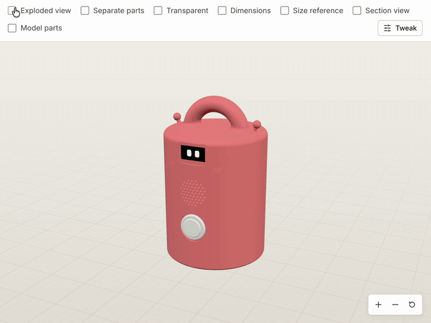
</p>

<p align="center"><sub>Solid, exploded, transparent, separated and section views of the same build, straight from the studio.</sub></p>

That one wish produced, in 15 minutes and 34 seconds:

| Output | This build |
|---|---|
| **Printed parts** | 9 print files with STEP and STL: 4 shell parts and 5 fit-test pieces |
| **Circuit board** | a routed 2-layer backplane PCB (KiCad project and Gerbers), DRC 0 errors, ERC 0 errors |
| **Firmware** | compiled ESP32-S3 firmware, 92 of 92 unit tests passing, flashable from the browser |
| **Manual** | an illustrated build guide: 16 steps, 19 rendered images and a wiring drawing |
| **Parts** | 23 bought parts with vendor sources and the listing each price was read from |
| **Checks** | 107 automated checks passed, 3 warnings and 1 failure: an overhang check, so the guide opens with *Do not print this design yet* |
| **Price** | ₹30,699 delivered, shown as an estimate, never as a binding quote |

---

## What it is

Wish Labs turns a sentence into a buildable electronic gadget. You talk to a design agent (type, speak, or start
from a sketch or a concept image). It asks the questions that matter, shows concept renders of designs it can
actually build, and then a deterministic engine does the engineering: CAD, circuit board, firmware, slicing,
pricing and the manual. Every claim the engine makes is checked by the engine, and anything it cannot verify is
labelled as such.

Every gadget shares one standard core: an ESP32-S3 board on a backplane PCB, keyed JST-PH cables to plug-in
modules, a custom 3D-printed shell and USB-C power. The core is assembled the same way every time; only the
shell and the modules change. That is the bet: many different products from one validated core.

<p align="center">
  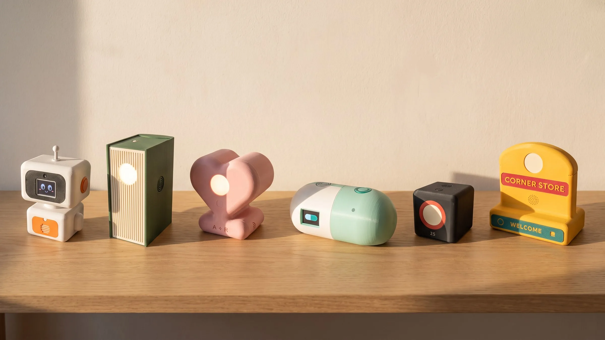
</p>
<p align="center"><sub>Six engine-validated designs. These product scenes are AI renders made from the Wish Labs CAD models, not photographs.</sub></p>

---

## What one wish produces

The export is a complete, self-checking build package (the Bedtime Story Robot's is about 375 files):

```text
lantern-robot/
├── PROJECT.md              the design record: brief, chosen concept, version
├── BUILD_GUIDE.md          illustrated assembly guide (stops you if a check failed)
├── SOFTWARE_SETUP.md       flash and configure the device
├── PARTS_EVIDENCE.md       where every part and price came from
├── spec.json  build.json  electrical.json  manifest.json (sha256 of every file)
├── cad/        assembly.step, assembly.glb, components, anchors, cable routes
├── print/      PRINT_Shell.stl, PRINT_BasePlate.stl, ... and TEST_* fit pieces
├── pcb/        backplane.kicad_pcb, backplane.kicad_sch, backplane-gerbers.zip
├── firmware/   PlatformIO project, firmware.bin, merged image, SHA256SUMS, tests
├── manual/     exploded.png, assembled.png, cable-end close-ups, ...
├── checks/     digital-checks.json, delivery-checks.json
├── order/      quote.json
├── references/ the saved vendor listings behind the prices
└── verify_delivery.py      re-checks the whole package, standard library only
```

---

## Inside the studio

<table>
  <tr>
    <td width="50%">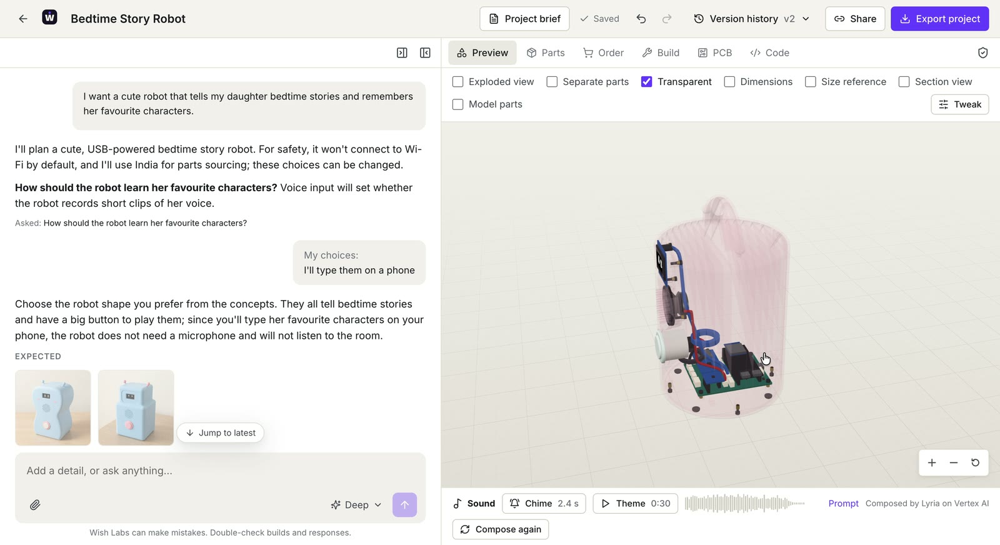<br><b>Talk it through.</b> The agent plans, asks one question at a time and shows the inside of the design.</td>
    <td width="50%">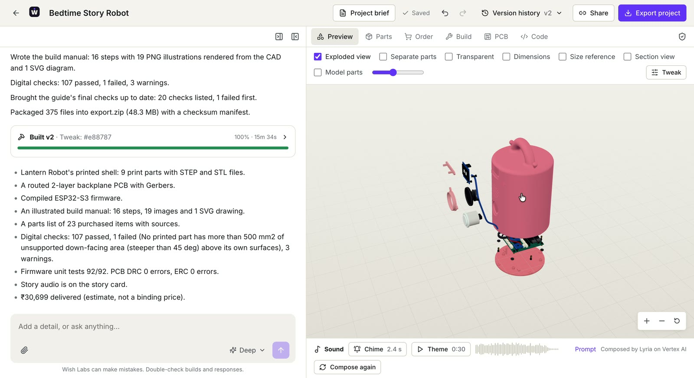<br><b>Exploded CAD.</b> Every printed and bought part, placed and collision-checked.</td>
  </tr>
  <tr>
    <td>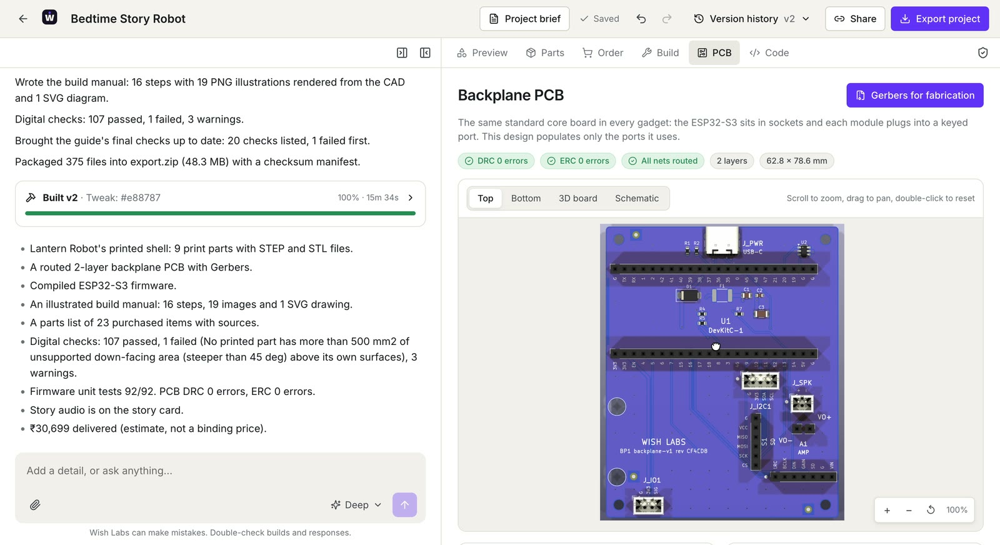<br><b>A real circuit board.</b> KiCad schematic and layout, autorouted with Freerouting, DRC and ERC clean.</td>
    <td>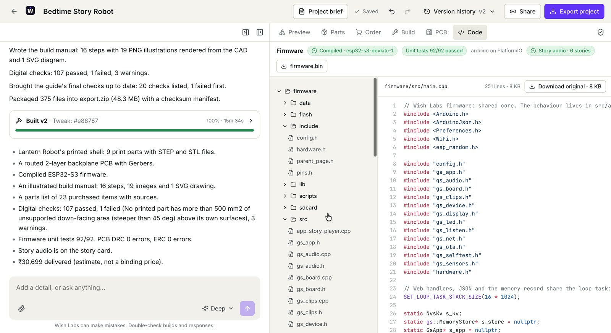<br><b>Firmware that compiles.</b> PlatformIO build for the ESP32-S3 with its unit tests.</td>
  </tr>
  <tr>
    <td>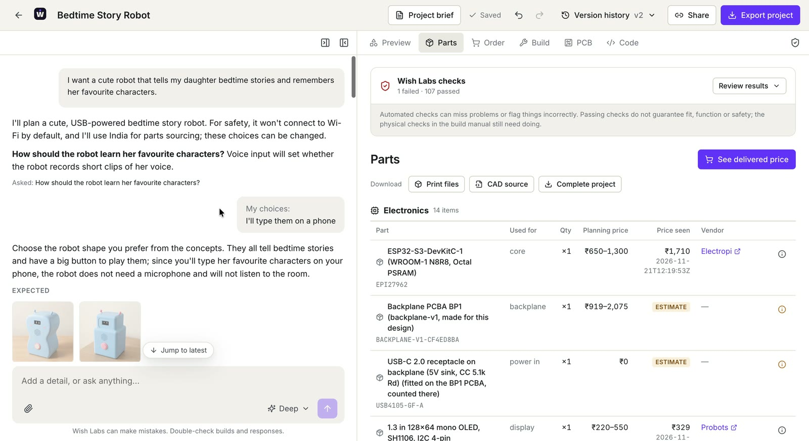<br><b>Prices with receipts.</b> Each bought part links to the vendor listing its price came from.</td>
    <td>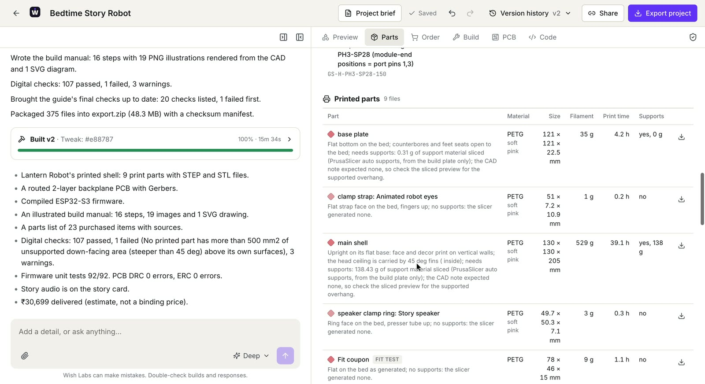<br><b>Ready to print.</b> Material, size, filament, print time and supports for every printed part.</td>
  </tr>
  <tr>
    <td>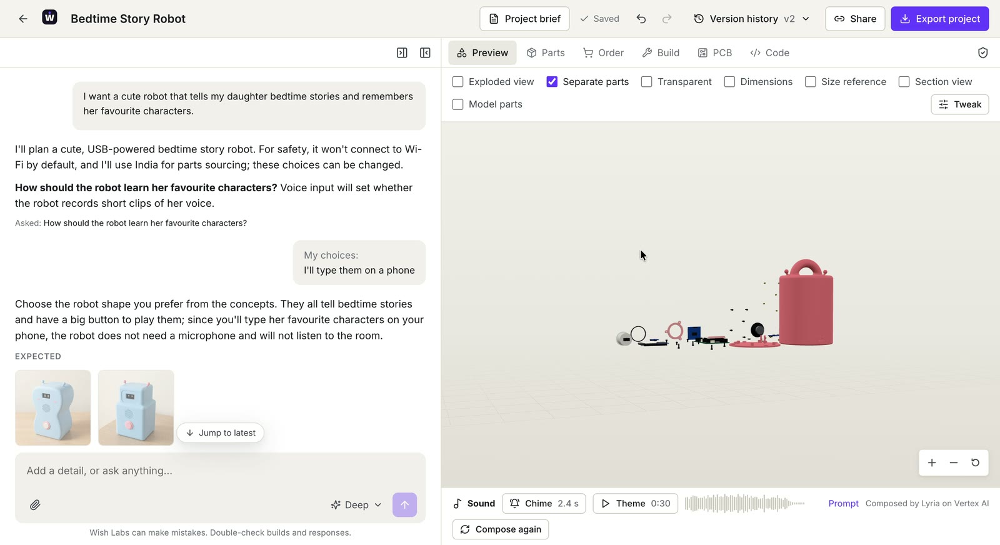<br><b>Separated parts.</b> The whole bill of materials laid out in 3D.</td>
    <td>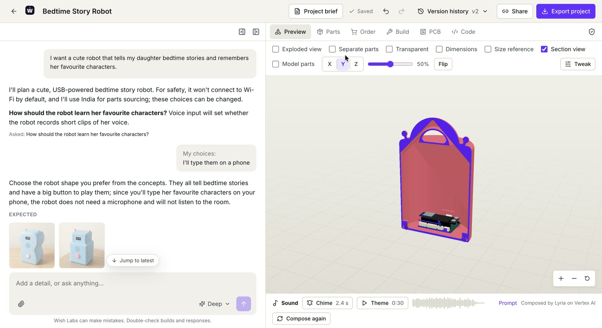<br><b>Section view.</b> Cut through any axis to see wall thickness and fit.</td>
  </tr>
</table>

---

## How it works

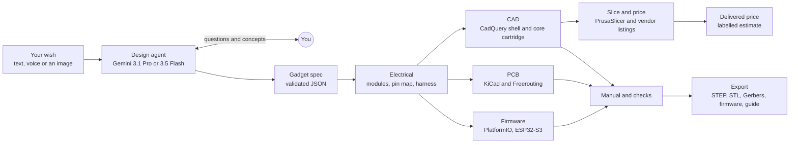

1. **Design agent.** Gemini on Vertex AI talks to you, then writes a gadget spec. It can only use parts from the
   catalog in [`studio/library/`](studio/library), so it cannot invent a component that is not in the catalog.
2. **Concepts.** Nano Banana Pro renders photoreal concept images of geometry the engine can actually build.
3. **Engine.** [`studio/engine/gstudio`](studio/engine/gstudio) runs the stages: electrical, CAD (CadQuery and
   OpenCascade), PCB (KiCad 9 and Freerouting), firmware (PlatformIO, Arduino on ESP32-S3), slicing (PrusaSlicer),
   pricing, the manual and the checks. Each stage is a plain Python function over a shared build context.
4. **Checks.** A full electronics build runs about 110 to 130 automated checks: collisions, wall thickness,
   unsupported overhangs, cable and connector matching, DRC and ERC, firmware unit tests, prices against saved
   listings, and a delivery check that re-hashes the export. A failed check is shown by name, in the studio and in
   the build guide.
5. **Sound and voice.** Lyria composes each gadget's chime and theme. Gemini Live lets you describe the wish out loud.

Architecture and API contracts: [`studio/docs/ARCHITECTURE.md`](studio/docs/ARCHITECTURE.md) and
[`studio/docs/API.md`](studio/docs/API.md).

---

## Benchmarks

Run on the live studio on 21 Nov 2026 in standard mode (Gemini 3.5 Flash), with no human help.

| Test | Result |
|---|---|
| [Text2CAD-Bench](https://huggingface.co/datasets/AICAD/Text2CAD-Bench), 10 public prompts across its three levels | **9 of 10 buildable.** Weighted invalid rate **10%**, against 29.7% to 41.3% published for general-purpose LLMs and 7.0% for the best domain model |
| 6 real gadget wishes, end to end | **5 of 6 buildable**, each with 45 to 131 checks, priced from ₹9,299 to ₹27,799 |
| Time and model cost | median 5.9 minutes and about $1 of model calls a part |

Small samples, one run each, and a stricter definition of "valid" than the benchmark's. Shape fidelity is not
measured yet: 1 of the 4 fully-dimensioned parts matched its prompt within 1 mm. The full tables, links to every
build and the caveats are in [`docs/BENCHMARKS.md`](docs/BENCHMARKS.md).

---

## Run it yourself

The studio runs locally with no cloud account: a local file store, a scripted design agent that replays a real
conversation, and a stand-in builder that serves the bundled examples.

```bash
git clone https://github.com/prasanna0070/wishlabs.git
cd wishlabs/studio

# 1. API server (Python 3.12)
cd web/server
python3.12 -m venv .venv && source .venv/bin/activate
pip install -r requirements.txt
ACCESS_KEY=dev AGENT=scripted uvicorn app.asgi:app --port 8080

# 2. Studio UI (Node 22), in a second terminal from studio/web/app
npm ci
GS_API=http://127.0.0.1:8080 npm run dev
# open http://localhost:5173/studio/ and sign in with the key "dev"
```

**With the real agent:** set `AGENT=gemini` and `GOOGLE_CLOUD_PROJECT=<your project>` after
`gcloud auth application-default login` (Vertex AI enabled).

**With real builds:** the heavy toolchain (CadQuery 2.8, KiCad 9, Freerouting 2.5, PlatformIO, PrusaSlicer 2.7) is
captured in [`studio/builder/Dockerfile`](studio/builder/Dockerfile). Run it as a service and point the server at it
with `BUILDER_URL`, or run the engine directly inside that image:

```bash
pip install -e studio/engine
python -m gstudio build studio/examples/bedtime-robot/spec.json _out/bedtime-robot
```

Tests: `pytest` in `studio/web/server`, `npm test` in `studio/web/app`, and `pytest` in `studio/engine` inside the builder image.

---

## Repository layout

```text
studio/
  web/app/        React, TypeScript and three.js studio (react-three-fiber, esp-web-tools for browser flashing)
  web/server/     FastAPI server: design agent, concept images, sound, voice, auth, share links, builder client
  engine/         gstudio: spec -> electrical -> CAD | PCB | firmware -> slice and price -> manual -> checks -> package
  library/        the parts catalog, backplane v1 and the module data every design is allowed to use
  builder/        the build service image (CadQuery, KiCad, Freerouting, PlatformIO, PrusaSlicer)
  site/           the landing page at wish.plugbook.si
  deploy/         Cloud Run, Cloud Build and load balancer scripts
  examples/       three reference gadget specs
sim/              the price engine and its Monte Carlo cost simulation
```

About 91,000 lines across the engine, server, studio and firmware templates, with 887 Python and 190 TypeScript tests.

---

## Status and limits

- **Pilot.** The hosted studio is invite-only for now. Run your own with the steps above.
- **Launch envelope.** USB-powered, indoor desk gadgets for adults. No batteries, mains power, heaters, strong
  actuators or products for children.
- **Prices are estimates.** They are computed from vendor listings, print time and labour assumptions, and
  labelled as estimates until a supplier confirms them.
- **Digital, not physical, verification.** The checks are computed from the models and the code. A passing
  build still needs a physical check.
- Vendor pages and datasheets are not redistributed here. `studio/library/tools/fetch_listings.py` saves your own
  copies with their hashes.

---

## Credits

Built by [Prasanna K](https://github.com/prasanna0070) in three weeks (1 to 21 Nov 2026) and submitted to the
Google AI Startup Buildathon India 2026. The Wish Labs logo is by [Niranjan](https://github.com/nrjai).
Engineering was done with Claude Code as a pair programmer; the commit history shows it as co-author.

## License

[MIT](LICENSE)
